

  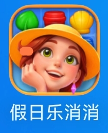

<h1 align="center">《假日乐消消》产品体验与系统拆解报告</h1>

  游戏类型：三消 + 海岛模拟建造 &nbsp;|&nbsp; 开发商：上海乐元素 &nbsp;|&nbsp; 上线时间：2025.06.25 &nbsp;|&nbsp; 平台：iOS / Android

---

## 目录

1. [游戏基本信息](#1-游戏基本信息)
2. [核心玩法拆解](#2-核心玩法拆解)
3. [关卡与难度设计](#3-关卡与难度设计)
4. [数值与成长系统](#4-数值与成长系统)
5. [奖励与反馈设计](#5-奖励与反馈设计)
6. [商业化设计](#6-商业化设计)
7. [UI/UX 与美术表现](#7-uiux-与美术表现)
8. [优缺点总结与设计启发](#8-优缺点总结与设计启发)

---

## 1. 游戏基本信息

### 1.1 产品基础资料

| 维度 | 产品信息 |
|---|---|
| **产品名称** | 《假日乐消消》 |
| **开发商** | 上海乐元素网络科技发展有限公司 |
| **上线时间** | 2025 年 6 月 25 日 |
| **运行平台** | Android / iOS |
| **核心玩法** | 经典交换式三消（主玩法）+ 海岛模拟建造（辅助 Meta 玩法） |
| **题材风格** | 海岛度假、休闲治愈 |
| **商业模式** | 免费下载 + 应用内购（F2P + IAP） |

  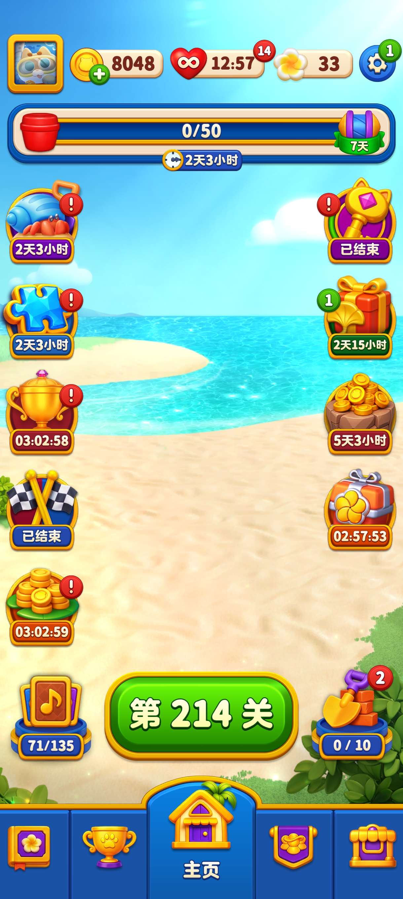 
  图 1-1：《假日乐消消》游戏主界面，以海岛度假场景为视觉中心

### 1.2 产品核心内容

#### a. 三消闯关系统

玩家通过交换相邻格子中的元素触发消除，在有限步数内清除障碍或收集指定目标；通过特定形状组合可生成高级特殊元素，带来多层次的清屏与连锁反馈，构成游戏的核心操作体验。

  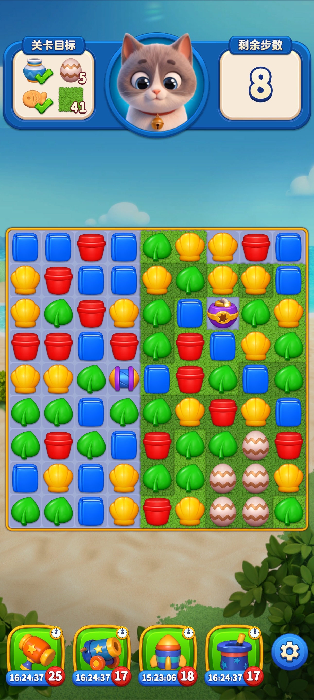 
  图 1-2：三消闯关构成游戏的核心即时操作体验

#### b. 海岛建设系统

玩家通过推进主线关卡获得核心成长资源「鸡蛋花」，逐步解锁并装扮海岛中的民宿与主题场景，为持续闯关提供清晰、可视化的长期目标。

<table align="center" style="margin: 0 auto;">
  <tr>
    <td align="center">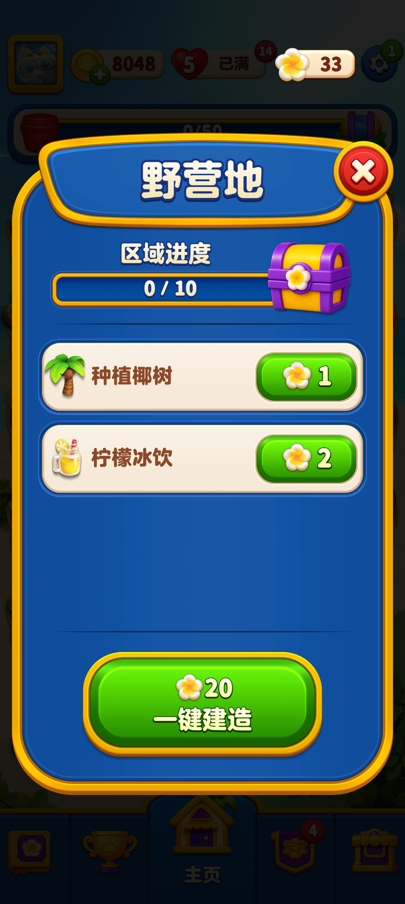 建设任务与鸡蛋花消耗</td>
    <td align="center">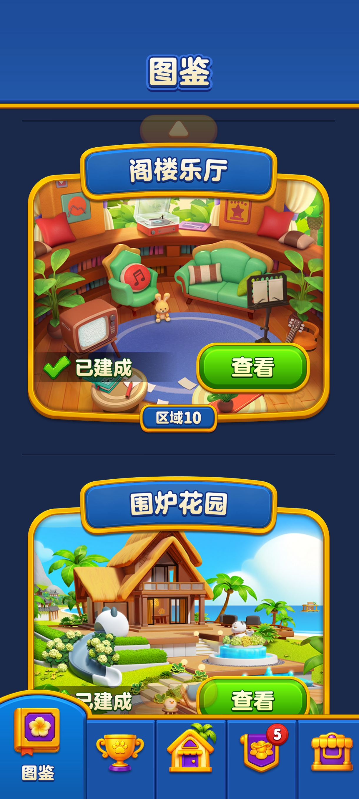 建设图鉴与已解锁主题场景</td>
  </tr>
</table>

图 1-3：通过消耗关卡产出的鸡蛋花逐步推进海岛建设与区域解锁

#### c. 社交系统

游戏通过公会成员互助（如请求与捐赠体力）、排行榜与限时竞赛等内容，拓展单机主线闯关之外的轻社交参与目标。

<table align="center" style="margin: 0 auto;">
  <tr>
    <td align="center">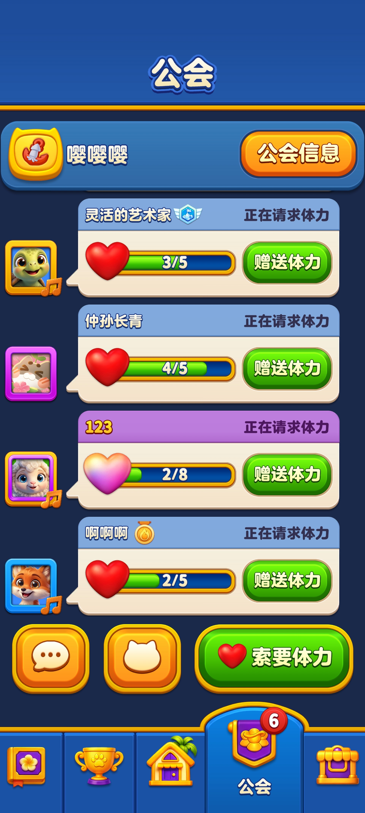 公会互助与成员互动</td>
    <td align="center">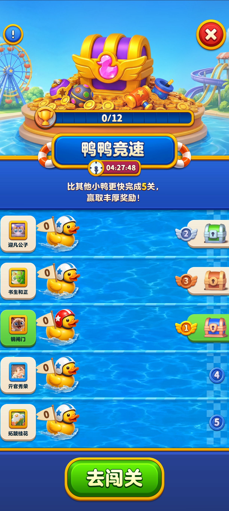 限时竞赛与排行比拼</td>
  </tr>
</table>

图 1-4：公会互助与活动竞赛系统拓展主线闯关之外的社交体验

#### d. 运营与活动系统

通过周期性主题活动、限时挑战与阶段性奖励发放，持续刺激玩家每日登录并提升活跃时长。

  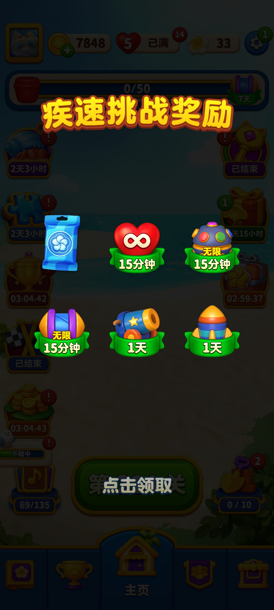 
  图 1-5：限时挑战与运营活动奖励领取界面（含卡包、限时无限体力与道具）

### 1.3 目标用户与需求分析

| 维度 | 核心特征与诉求 |
|---|---|
| **轻度休闲玩家** | 偏好利用碎片化时间娱乐，追求低门槛、轻松直接的即时爽感 |
| **三消策略爱好者** | 享受关卡解谜、特殊元素合成与大招组合带来的操作乐趣 |
| **装扮与收集玩家** | 对海岛装饰、图鉴收集与场景解锁等长期可视化成长有强烈满足感 |
| **轻度竞争玩家** | 具备一定好胜心，易被短期连胜 Buff、限时排名竞赛吸引 |

<table align="center" style="margin: 0 auto;">
  <tr>
    <td align="center"> 即时娱乐：三消闯关</td>
    <td align="center">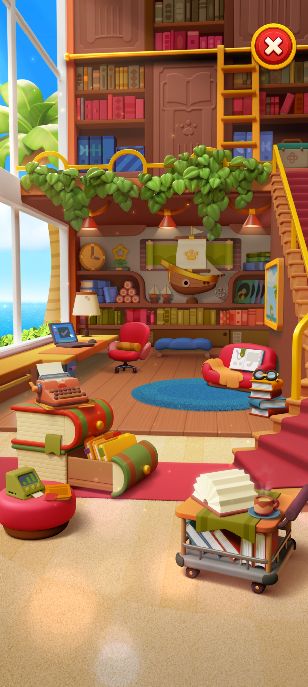 成长收集：海岛建设</td>
    <td align="center"> 竞争互动：活动竞赛</td>
  </tr>
</table>

图 1-6：游戏通过三大内容模块分别满足玩家的多层次核心需求

### 1.4 产品核心体验总结

> - **即时体验（局内）**：三消闯关 —— 操作、消除、连锁反馈、关卡结算。
> - **长期体验（局外）**：海岛建设 —— 获取资源、完成建设、解锁场景、成长反馈。

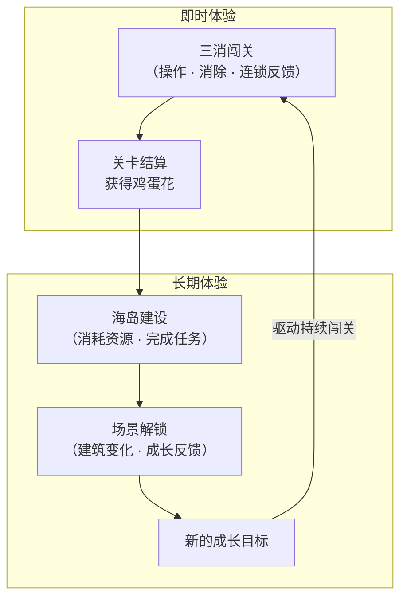

图 1-7：即时消除体验与长期建设体验共同构成产品核心循环

---

## 2. 核心玩法拆解

### 2.1 三消基础规则

游戏采用经典交换式三消玩法：玩家交换相邻棋子，使横向或纵向形成三个及以上相同元素的连续排列并触发消除；随后上方元素下落、顶部补充新棋子，若再次满足消除条件则自动触发连锁消除。

- **基础操作闭环**：选择元素 → 交换元素 → 触发消除 → 下落补充 → 连锁反馈 → 目标与步数判定。
- **核心设计价值**：
  - **低学习成本**：单指滑动交换即可上手，极大降低泛用户初次体验门槛。
  - **持续策略决策**：每一步交换均需权衡消除位置、底层塌陷与关卡目标进度。
  - **随机连锁惊喜**：棋子掉落带来适度不确定性，在策略之外提供意外连消的正向爽感。

<table align="center" style="margin: 0 auto;">
  <tr>
    <td align="center">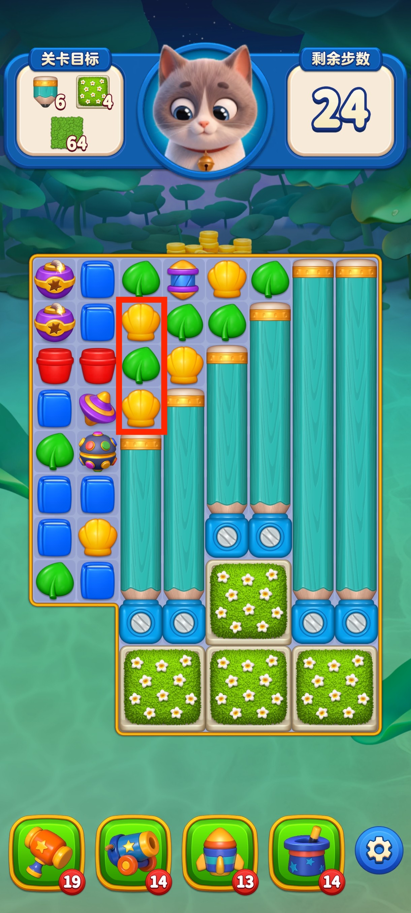 交换前棋盘状态</td>
    <td align="center">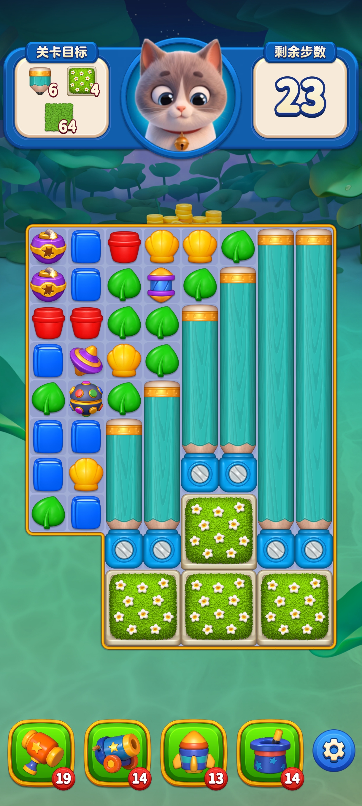 消除后空位与元素下落补充</td>
  </tr>
</table>

图 2-1：通过交换相邻元素形成三连消除及后续棋盘下落变化

### 2.2 特殊元素机制

特殊元素是三消玩法从「基础消除」迈向「策略组合」的关键桥梁。它让玩家的操作目标从被动寻找普通三消，转变为主动规划特殊元素的合成位置与引爆时机。

#### a. 合成规则与消除机制

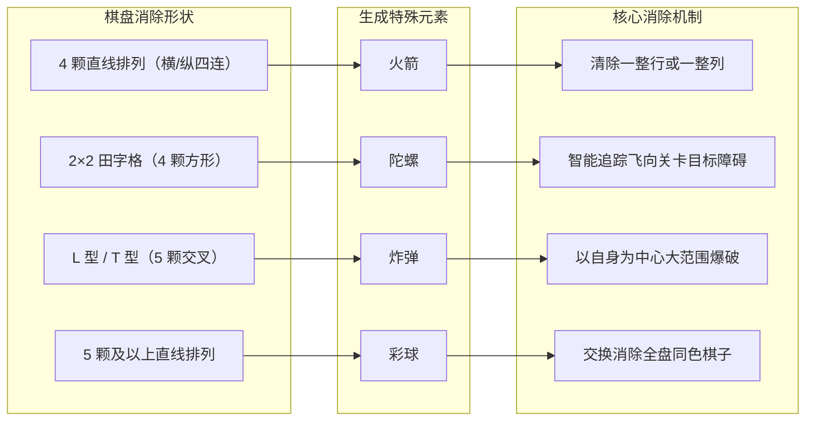

图 2-2：《假日乐消消》四类核心特殊元素的合成条件与消除机制

#### b. 实机触发效果对照

<table align="center" style="margin: 0 auto;">
  <tr>
    <td align="center">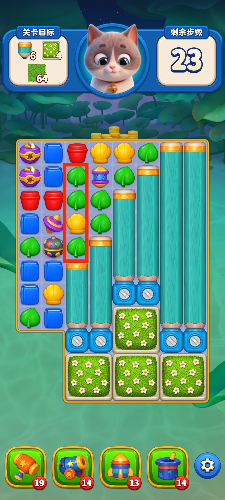 火箭触发前</td>
    <td align="center">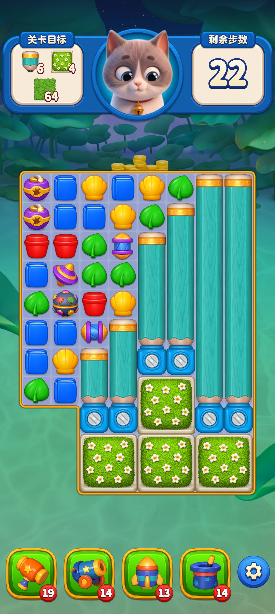 火箭触发后（直线清除）</td>
    <td align="center">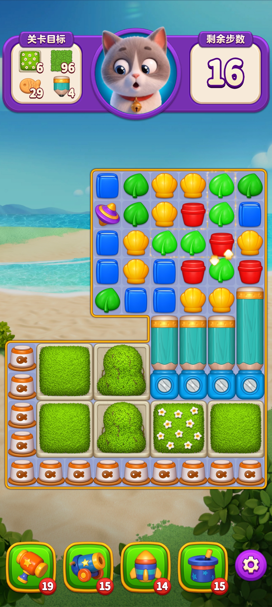 炸弹触发前</td>
    <td align="center">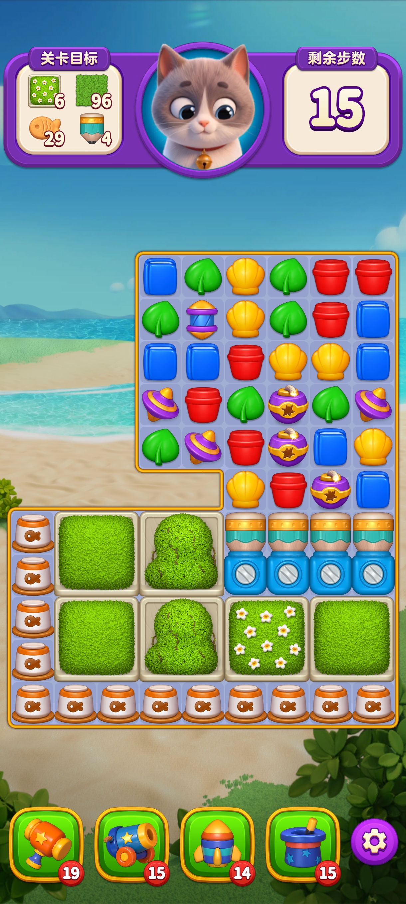 炸弹触发后（范围爆破）</td>
  </tr>
  <tr>
    <td align="center">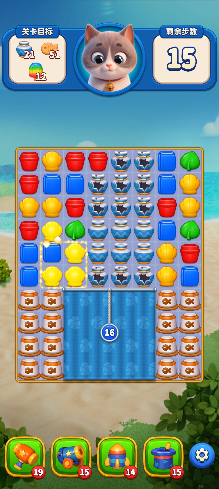 陀螺触发前</td>
    <td align="center">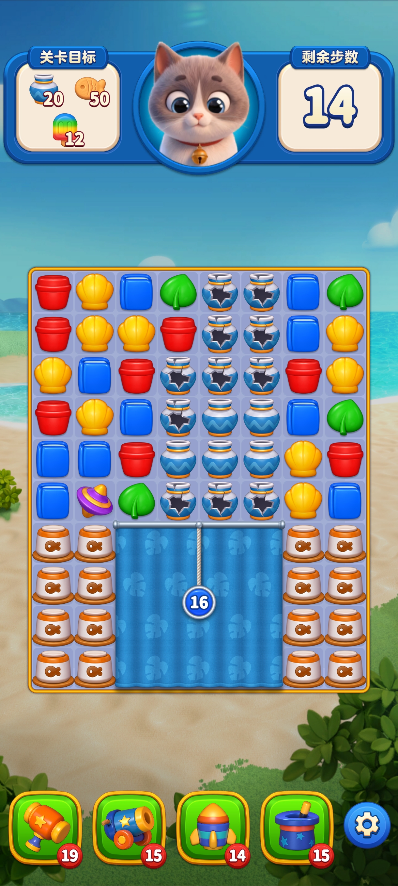 陀螺触发后（定向打击）</td>
    <td align="center">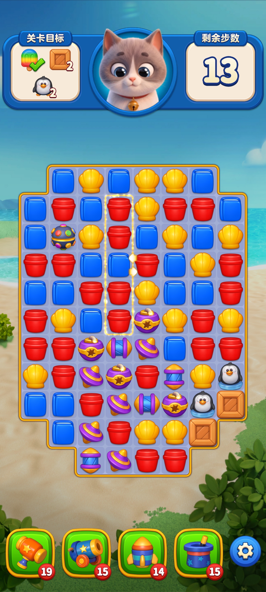 彩球触发前</td>
    <td align="center">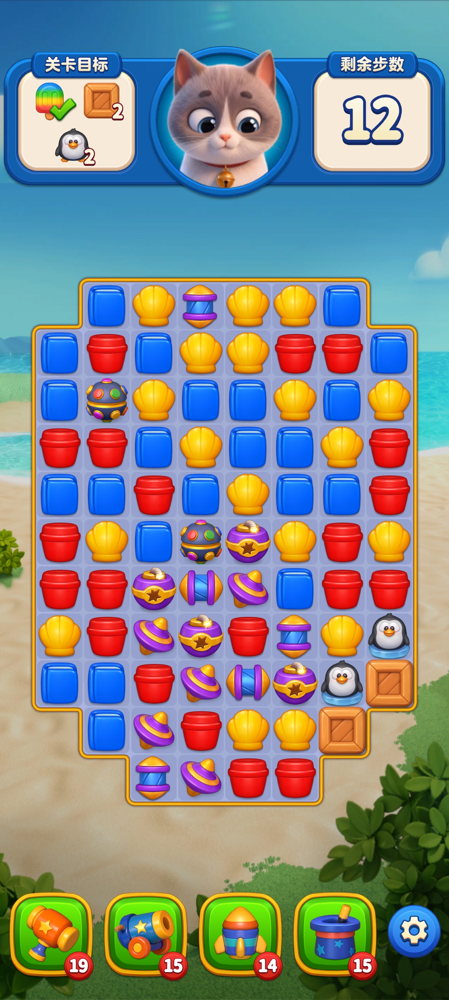 彩球触发后（同色清屏）</td>
  </tr>
</table>

图 2-3：火箭、炸弹、陀螺、彩球四类特殊元素触发前后的实际棋盘效果

> **设计作用小结**：特殊元素不仅扩大单步消除效率，更通过「陀螺」智能追踪解决了传统三消“远端死角够不着”的痛点，同时借由强视听特效放大爽感，引导玩家追求高阶组合。

### 2.3 特殊元素组合机制

当两个相邻的特殊元素直接互换时，将触发远超单一特效的复合清除效果，是攻克高难关卡的核心策略手段：

| 组合类型 | 核心效果与策略价值 |
|---|---|
| **同类型互换**（如火箭+火箭、炸弹+炸弹） | 显著扩大原有范围，形成十字贯通或超大区域爆破 |
| **异类型组合**（如火箭+炸弹、陀螺+火箭/炸弹） | 产生复合清除效果；陀螺携带特效可实现远程定点大范围打击 |
| **彩球 + 其他特殊元素** | 将全盘对应颜色棋子批量转化为特效并连锁引爆，实现清屏级收益 |
| **彩球 + 彩球（终极组合）** | 全盘无差别清扫一层障碍与所有棋子，提供峰值解压反馈 |

  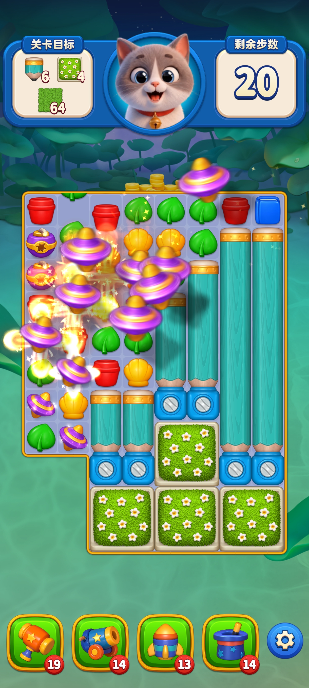 
  图 2-4：特殊元素相邻互换触发的复合大范围清除效果

### 2.4 辅助道具系统

区别于棋盘内自然合成的「特殊元素」，「辅助道具」由系统产出或商业化提供，允许玩家在关键局面主动介入棋盘状态：

| 道具类型 | 核心功能 | 主要使用场景 |
|---|---|---|
| **单格清除（如锤子）** | 定点清除指定位置的单个棋子或障碍 | 解决角落死角或差最后 1 个目标 |
| **行列清除** | 清除一整行或一整列棋子与障碍 | 处理集中分布的成排障碍 |
| **区域爆破** | 清除指定范围内的密集元素 | 快速打开受限的开局空间 |
| **颜色/全局辅助** | 清除或重排特定棋子 | 应对特定颜色收集或无解死局 |
| **步数补充** | 增加剩余操作步数 | 临近通关但步数耗尽时补救 |

> **系统设计价值**：辅助道具承担四重职责 —— ① 降低卡关挫败感；② 增加残局决策空间；③ 串联局外资源循环；④ 承接商城与礼包商业化消耗。

<table align="center" style="margin: 0 auto;">
  <tr>
    <td align="center">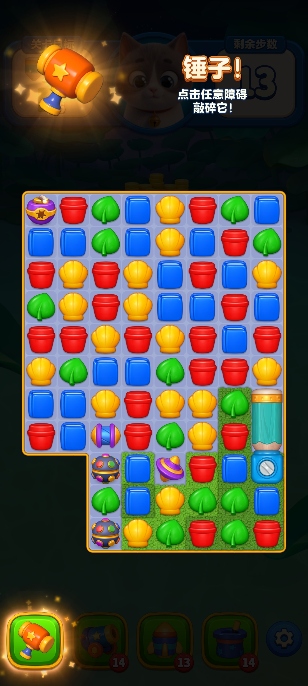 局内道具栏与使用锤子前</td>
    <td align="center">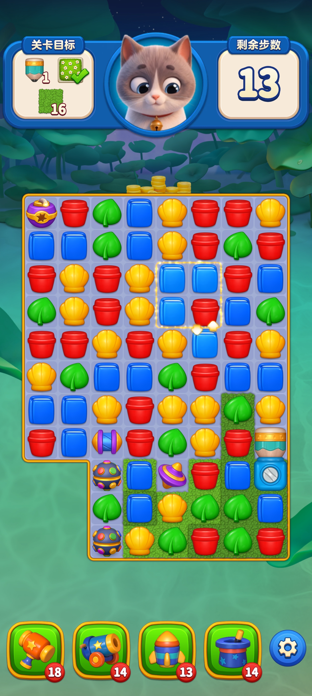 锤子单格定点清除后的棋盘变化</td>
  </tr>
</table>

图 2-5：局内辅助道具（以单格清除道具「锤子」为例）使用前后对比

### 2.5 关卡内循环

单局关卡内通过 **「进入关卡 → 观察棋盘制定策略 → 交换消除与道具介入 → 棋盘下落与进度更新 → 胜负判定」** 形成高频操作闭环：

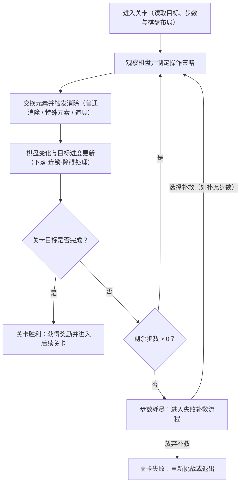

图 2-6：关卡内单局操作与胜负分支循环流程图

<table align="center" style="margin: 0 auto;">
  <tr>
    <td align="center">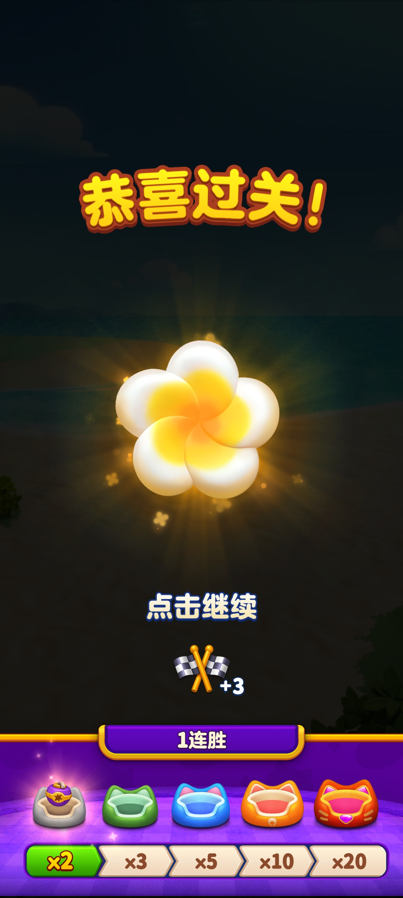 关卡胜利结算界面</td>
    <td align="center">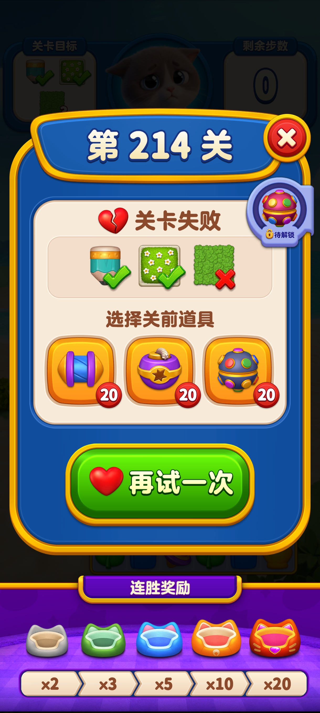 关卡失败提示界面</td>
  </tr>
</table>

图 2-7：胜利奖励与失败反馈共同构成单局体验闭环

### 2.6 关卡外循环

关卡外循环决定玩家在单局结束后是否具备持续回流的动力，围绕 **「通关获资源 → 积累鸡蛋花 → 完成海岛建设 → 解锁新场景 → 产生新目标」** 展开。

#### 关卡内外循环对比

| 对比维度 | 关卡内循环（Core Loop） | 关卡外循环（Meta Loop） |
|---|---|---|
| **核心行为** | 消除、策略操作、完成目标 | 闯关、积累资源、建设场景 |
| **时间尺度** | 单局数分钟 | 多局积累及中长期游玩 |
| **核心反馈** | 消除特效、目标进度、胜负结果 | 建筑落成、场景解锁、阶段宝箱 |
| **玩家动力** | 攻克当前关卡挑战 | 推进长期海岛养成目标 |
| **系统作用** | 提供高频即时多巴胺体验 | 承接局内产出并建立持续留存锚点 |

> **系统平衡要点**：局内奖励产出与局外建设消耗的匹配度至关重要 —— 产出过低会削弱闯关价值感，建设节奏过慢会降低成长参与度，两者脱节则容易割裂为两个孤立模块。

<table align="center" style="margin: 0 auto;">
  <tr>
    <td align="center">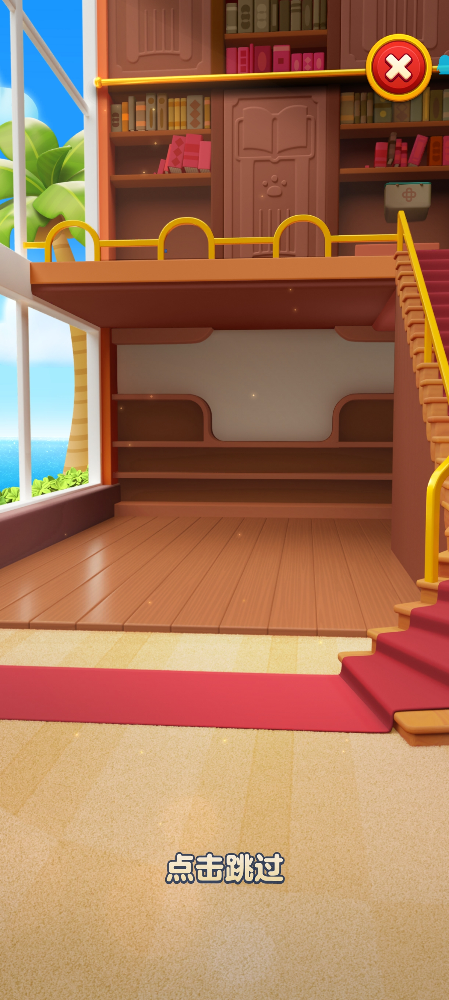 建设前空地状态</td>
    <td align="center"> 建设后场景与装饰变化</td>
  </tr>
</table>

图 2-8：海岛同一区域建设前后的直观视觉成长反馈

<table align="center" style="margin: 0 auto;">
  <tr>
    <td align="center"> 关卡胜利结算产出鸡蛋花</td>
    <td align="center"> 海岛建设任务消耗鸡蛋花</td>
  </tr>
</table>

图 2-9：通过鸡蛋花的产出与消耗打通局内玩法与局外成长

### 2.7 核心玩法拆解总结

《假日乐消消》的玩法架构可由下至上归纳为四个递进层次，并通过资源奖励将局内即时体验与局外长线驱动紧密咬合：

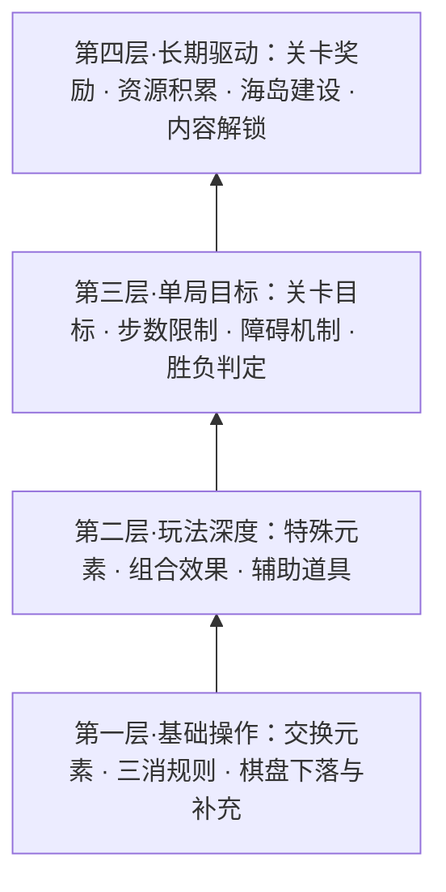

图 2-10：《假日乐消消》核心玩法四层结构图

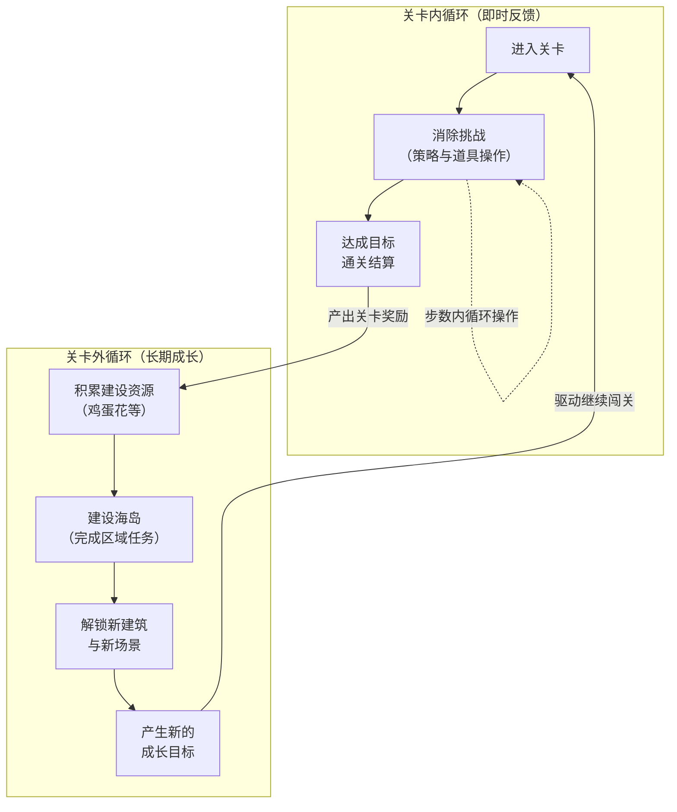

图 2-11：关卡内外双循环协同驱动总图

---

## 3. 关卡与难度设计

> **核心观察**：游戏通过「差异化收集目标 + 特色海岛障碍物 + 异形棋盘」制造关卡新鲜感，并借助 **普通关 → 困难关 → 舒缓关 → 超难关** 的波浪式难度节奏控制玩家心流。

### 3.1 典型关卡结构与类型差异

  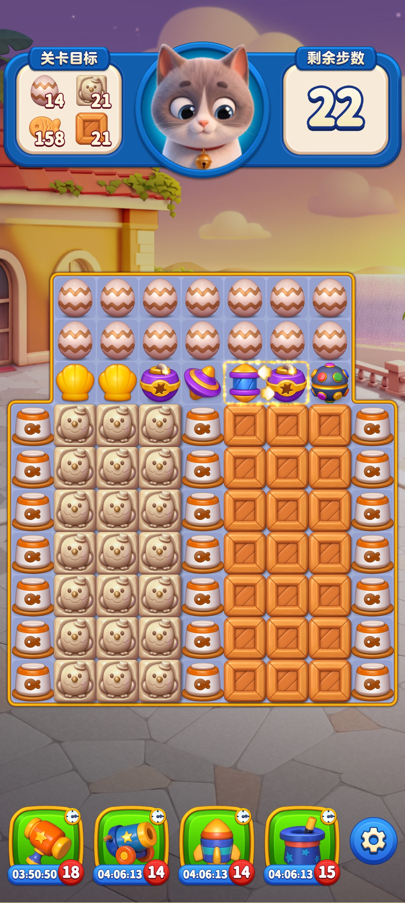 
  图 3-1：典型关卡棋盘布局（包含顶部收集目标、剩余步数与棋盘障碍分布）

<table align="center" style="margin: 0 auto;">
  <tr>
    <td align="center"> 关卡类型示例一</td>
    <td align="center">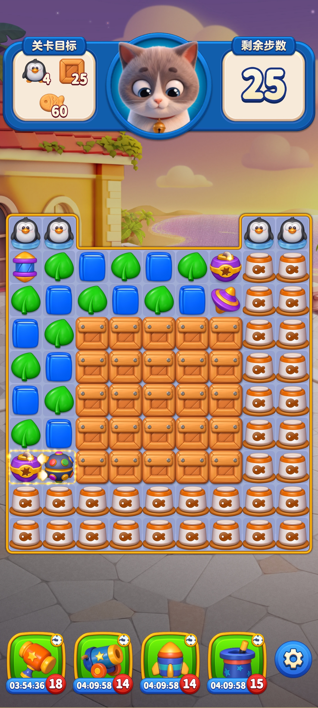 关卡类型示例二</td>
    <td align="center">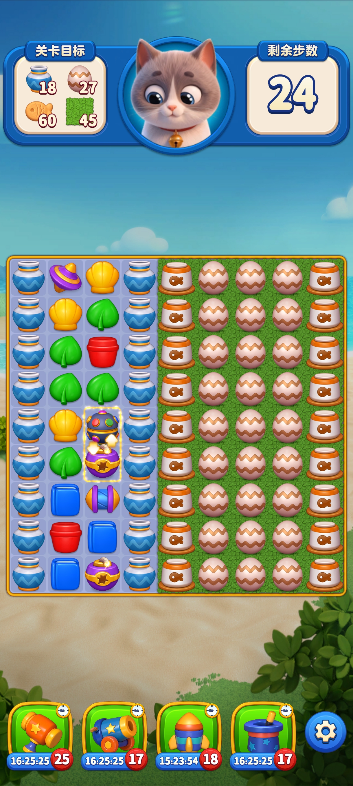 关卡类型示例三</td>
  </tr>
</table>

图 3-2：不同关卡通过目标组合、障碍机制与棋盘地形变化提供持续新鲜感

### 3.2 波浪式难度节奏分析

- **普通关**：障碍稀疏、步数充裕，用于引导新机制与积累连胜 Buff。
- **困难关**：障碍密集度提升、步数紧凑，要求玩家主动合成火箭/陀螺/炸弹破局。
- **超难关**：异形地形叠加复合障碍，步数卡在理论消耗边缘，重点承接连胜保护与道具/续步消耗。
- **舒缓释放关**：紧随高难关之后，降低门槛让玩家集中释放特效、恢复正向情绪。

---

## 4. 数值与成长系统

> **核心观察**：游戏以「鸡蛋花、金币、体力、道具」四类核心资源构建闭环经济，将单局闯关表现平滑转化为海岛区域的阶段性成长进度。

### 4.1 核心资源总览与流向

   
  图 4-1：主界面顶部资源栏集中呈现金币、体力与鸡蛋花当前存量

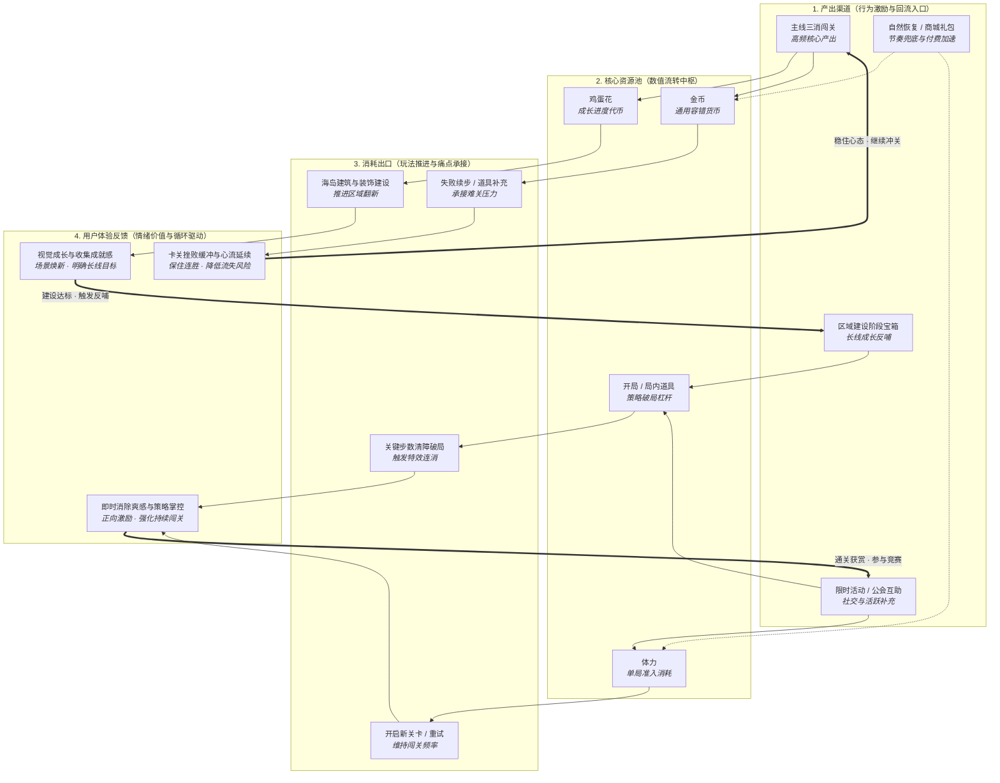

图 4-2：核心资源「产出 → 流转 → 消耗 → 体验反馈」闭环结构与用户体验驱动关系图

### 4.2 海岛长线成长阶段

<table align="center" style="margin: 0 auto;">
  <tr>
    <td align="center"> 建设初期状态</td>
    <td align="center"> 单区域建成效果</td>
    <td align="center"> 多区域图鉴解锁进度</td>
  </tr>
</table>

图 4-3：从单区域建设变化到多区域图鉴解锁，形成清晰的阶段性成长反馈

---

## 5. 奖励与反馈设计

> **核心观察**：游戏构建了 **「单局结算（即时）→ 连胜加成（中频）→ 限时活动（周期）」** 三层递进奖励体系，兼顾爽感放大与流失拦截。

<table align="center" style="margin: 0 auto;">
  <tr>
    <td align="center"> 单局通关奖励结算（即时正向反馈）</td>
    <td align="center">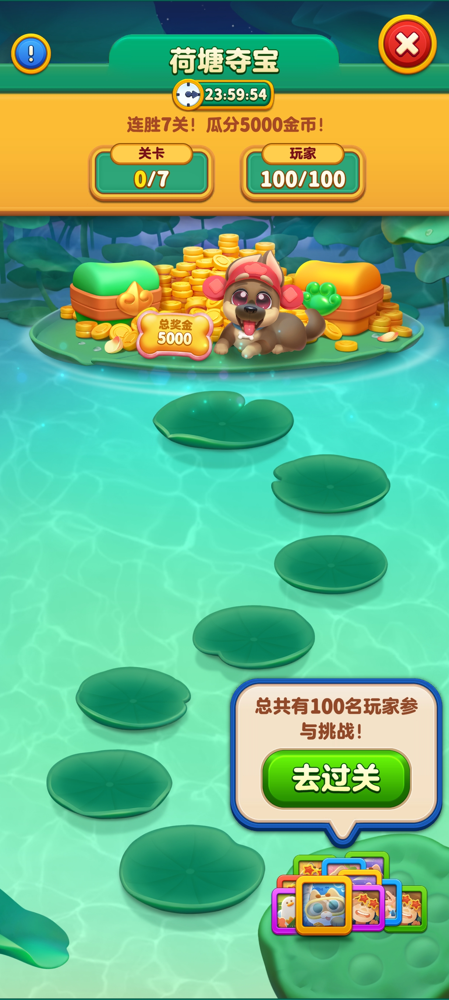 连胜奖励机制（递进加成与断连损失感）</td>
  </tr>
</table>

图 5-1：关卡胜利结算与连胜激励机制

<table align="center" style="margin: 0 auto;">
  <tr>
    <td align="center"> 限时活动进度与排名目标</td>
    <td align="center"> 活动阶段奖励集中发放界面</td>
  </tr>
</table>

图 5-2：限时活动与运营奖励为主线闯关提供额外目标牵引与道具补给

---

## 6. 商业化设计

> **核心观察**：商业化以 **「常驻商城打底 + 限时礼包促销 + 步数耗尽情绪点补救」** 三条路径展开，高度贴合休闲三消用户的冲动消费心理。

<table align="center" style="margin: 0 auto;">
  <tr>
    <td align="center">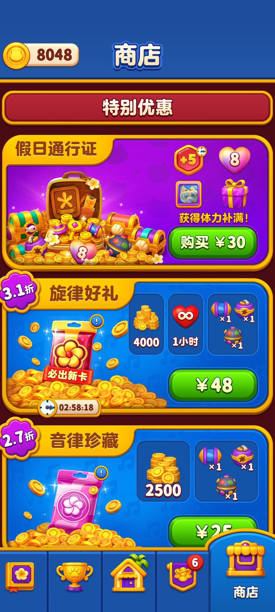 商城主界面：金币档位与常驻礼包</td>
    <td align="center">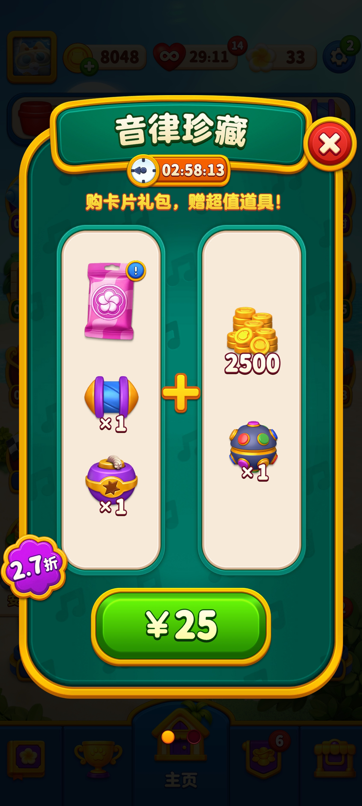 限时商品：倒计时与折扣制造紧迫感</td>
    <td align="center">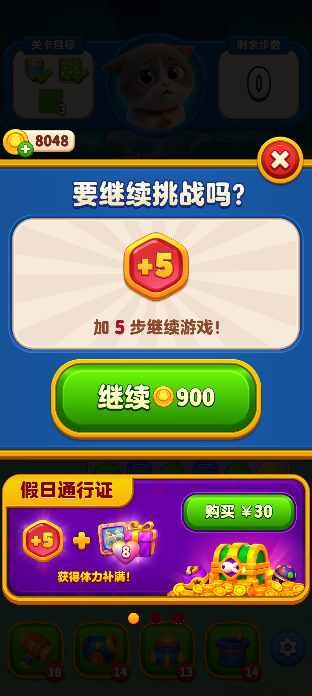 失败补救：残局续步核心变现节点</td>
  </tr>
</table>

图 6-1：《假日乐消消》三大核心商业化付费场景拆解

---

## 7. UI/UX 与美术表现

> **核心观察**：从策划视角看，本作美术与交互的核心价值在于**降低泛用户认知门槛、放大单步操作爽感**——高明度的海岛度假画风强化休闲治愈定位，局内多层次消除特效则有效承接三消核心循环的即时反馈。

<table align="center" style="margin: 0 auto;">
  <tr>
    <td align="center">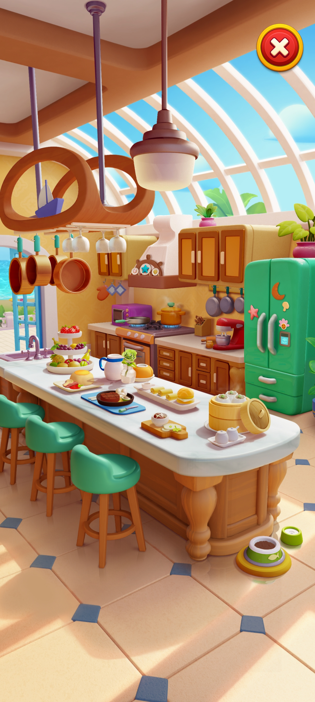 明亮治愈的海岛主题场景与视觉成长表现</td>
    <td align="center"> 多层次消除爆发特效强化单步操作爽感</td>
  </tr>
</table>

图 7-1：海岛治愈画风与局内消除爆发特效共同支撑核心体验

---

## 8. 优缺点总结与设计启发

### 8.1 核心系统关系总结

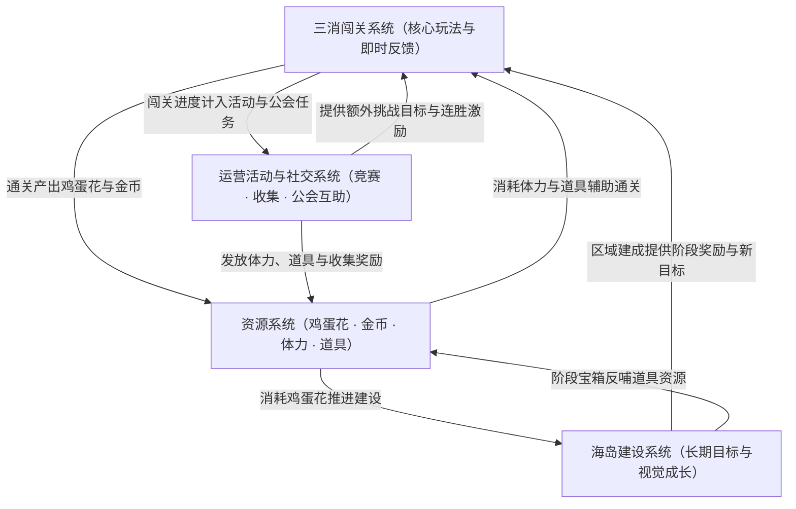

图 8-1：三消闯关、资源数值、海岛建设与运营社交四大系统耦合关系图

### 8.2 核心优势与流程级痛点对照

<table align="center" style="margin: 0 auto;">
  <tr>
    <td align="center"> <strong>优势</strong>：陀螺与大招组合爽感强、策略深度足</td>
    <td align="center"> <strong>优势</strong>：海岛建设成长可见、承接局内产出</td>
    <td align="center"> <strong>商业化痛点</strong>：中后期卡关高度依赖残局续步</td>
    <td align="center"> <strong>长线痛点</strong>：海岛建设偏线性、后期驱动衰减</td>
  </tr>
</table>

图 8-2：从策划视角对照产品核心优势与商业化、长线留存流程痛点

### 8.3 商业化与长线流程优化思路

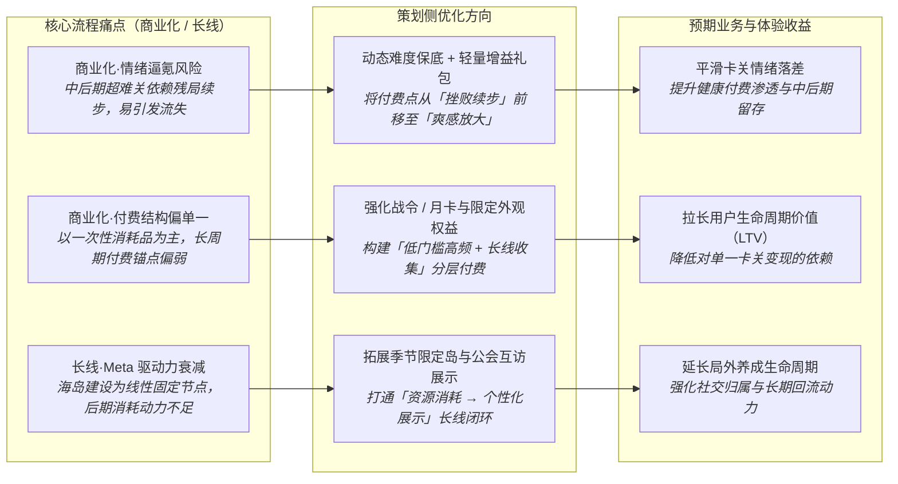

图 8-3：针对商业化转化节奏与长线 Meta 留存瓶颈的策划优化思路

