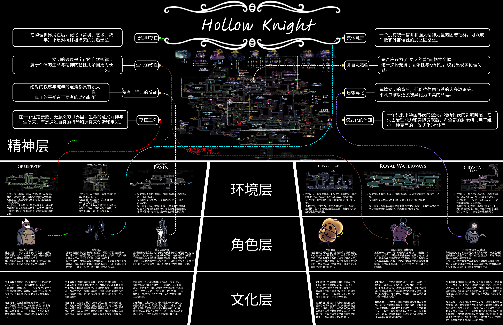
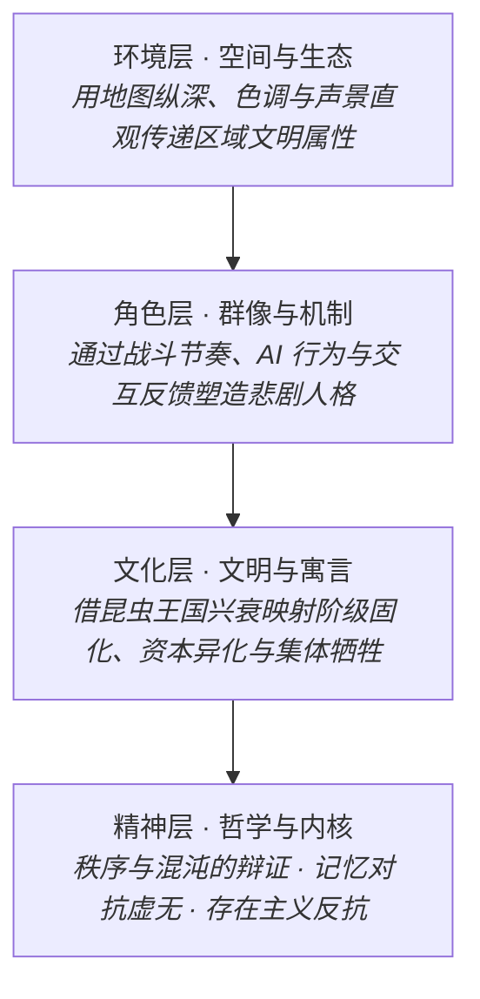

  游戏类型：类银河战士恶魔城（Metroidvania） &nbsp;|&nbsp; 开发商：Team Cherry &nbsp;|&nbsp; 拆解维度：世界观架构 · 环境叙事 · 角色机制 · 叙事方法论

> **核心结论**：《空洞骑士》之所以在几乎没有线性过场动画的前提下，依然能构建出极具厚重感的悲剧史诗，关键在于它将抽象的哲学母题（秩序、牺牲、记忆、存在）层层下沉到了**可探索的垂直地图、可交互的 Boss 机制与碎片化的环境意象**之中，实现了「空间即叙事、机制即人设」。

---

## 拆解总览导图

   
  图 1：《空洞骑士》四层文化构成与叙事隐喻总览导图（<a href="/_pages/works/media/hollow.png" target="_blank">点击查看高清原图</a>）

图 2：《空洞骑士》由表及里的四层叙事架构映射关系

---

## 一、 环境层：用垂直空间与区域生态讲故事

圣巢（Hallownest）的地图并非孤立关卡的拼接，而是一座**自上而下按社会层级与历史地层排布的立体文明切片**。玩家每深入一层，视觉色调、音乐情绪与敌人生态都会同步切换，无需文字说明即可建立强烈的文化认知：

| 核心区域 | 视觉与生态意象 | 文化与社会隐喻 | 叙事落地手法 |
| :--- | :--- | :--- | :--- |
| **苍绿之径** *(Greenpath)* | 茂密植被、酸液池、苔藓生物 | **自然与本能**：生命在废墟中顽强生长，代表文明介入前的原始生机 | 与遗忘十字路的灰暗形成强烈色彩反差，建立“乌恩的梦境”自然信仰 |
| **真菌荒地** *(Fungal Wastes)* | 孢子雾气、蘑菇群落、螳螂村 | **集体意志与边界**：个体消亡化为族群养料，独立社群凭自律抵御感染 | 螳螂族以部落规则与武力守住领地，与被感染的王国形成鲜明对照 |
| **泪水之城** *(City of Tears)* | 永恒细雨、哥特尖塔、蓝灰冷调 | **繁华落幕与阶级固化**：昔日工业与王权中心在雨中沉沦，只余空壳 | 上层优雅大厅与下层破败街道的空间对比，配合悠远弦乐烘托哀悼感 |
| **皇家水道** *(Royal Waterways)* | 阴暗管道、污水、畸变虫类 | **底层与遗忘**：辉煌都城的排泄系统，是被文明繁华遮蔽的阴暗面 | 压抑狭窄的通道布局与潮湿音效，强化被放逐者与底层生态的边缘感 |
| **水晶山峰** *(Crystal Peak)* | 刺目粉紫晶矿、轰鸣机械、采矿虫 | **资本、贪婪与异化**：无节制开采将矿工异化为永不停歇的劳作工具 | 矿工至死仍在机械挥镐的行为循环，将“异化”直接可视化为怪物 AI |
| **古老盆地** *(Ancient Basin)* | 死寂灰白、空旷废墟、深渊底部 | **历史、虚空与代价**：被王权刻意掩埋的禁忌之地，见证容器计划的残酷 | 极简留白与几乎消失的背景音乐，让深渊中成堆容器残骸极具冲击力 |

---

## 二、 角色层：玩法机制与悲剧人格的统一

《空洞骑士》极少用长篇对白交代人物背景，而是让**角色的战斗方式、所处空间与交互反馈直接成为人设本身**：

- **教师·莫诺蒙（Monomon the Teacher）**：理性与求知的殉道者。为封印辐光主动化作守梦者，却在察觉封印终将崩塌后，借奎若之手引导小骑士打破自己的沉睡——展现了明知结局仍坚持真相的清醒与克制。
- **螳螂领主（Mantis Lords）**：荣誉与自律的化身。拒绝接受白王庇护与辐光诱惑，以高强度、讲求公平节奏的 Boss 战考验玩家；击败后全族停止敌对并向玩家鞠躬致敬，用**行为态度的反转**而非台词，让玩家切身感受到高贵的部族荣誉。
- **白王（Pale King）**：极端理性与悲剧傲慢的统治者。为换取“永恒王国”而实施残酷的容器计划，将无数个体工具化；游戏中白色宫殿近乎偏执的精密陷阱关卡，本身就是白王极端秩序观的空间化外显。
- **白色夫人（White Lady）**：衰败贵族与“仪式化体面”的象征。在失去治理能力与现实支撑后自我囚禁于王后花园，仍维系着昔日王室的礼仪与尊严，折射出旧秩序空壳化的宿命。
- **奥格瑞姆（Ogrim / 粪虫防御者）**：旧时代忠诚骑士的挽歌。即使王国覆灭、同袍离散，仍独自守在肮脏的皇家水道深处守护昔日荣耀，战斗中爽朗的呼喊与战后落寞的雕塑形成强烈悲情反差。
- **水晶守卫（Crystal Guardian）**：被欲望异化的工具人。端坐于矿脉长椅上、被水晶吞噬心智，甚至连“休息点”这一安全符号都被侵占，直观映射出贪婪对个体主体性的剥夺。

---

## 三、 文化层与精神层：双重辩证张力

在表层的昆虫奇幻外衣之下，游戏用两组贯穿始终的哲学张力托起了整部作品的精神深度：

### 1. 集体秩序 vs 个体异化
- **非自愿牺牲的伦理拷问**：白王为追求“更大的善”制造空洞容器，抛出了经典功利主义命题——辉煌文明的代价，往往由沉默的大多数与被剥夺意志的个体承担。
- **秩序与混沌的动态平衡**：白王代表绝对秩序（冰冷、压抑、最终僵化），辐光代表原始混沌与本能（狂热、吞噬、丧失自我）。两者走向极端皆导致毁灭，而真正保有尊严的，反而是如螳螂族般在自律与本能间守住边界的社群。

### 2. 文明衰败 vs 存在主义反抗
- **记忆即存在**：当物理城邦化作废墟，“梦境之钉”所勾连的记忆、歌谣与执念，成为对抗终极遗忘的最后堡垒。
- **反英雄的存在主义胜利**：游戏打破了“天选英雄拯救世界”的传统爽文模板——圣巢注定无法回到往日荣光。玩家操控无名、无声的小骑士，在必将衰败的世界里不断攀爬、战斗与抉择，**用行动本身赋予虚无以意义**。

---

## 四、 面向游戏策划的设计启发

从策划实操角度复盘，《空洞骑士》有三条可直接复用的叙事与系统设计方法论：

1. **空间即叙事（Spatial Storytelling）**：在关卡立项阶段就将「世界观层级」与「地图纵深」绑定（如繁华都城在上、排泄水道在中、禁忌深渊在底），让玩家在跑图过程中自然完成世界观吸收，大幅降低文本阅读门槛。
2. **机制即人设（Gameplay-Narrative Alignment）**：优先思考如何用**交互规则、Boss 节奏与战后反馈**表达角色性格（如螳螂族战后致敬、矿工机械采矿），而不是把背景故事全塞进图鉴与弹窗对白。
3. **留白驱动探索循环（Fragmented Narrative Loop）**：将完整剧情拆解为环境线索、碎片台词与隐藏区域，把“拼凑真相的好奇心”转化为银河恶魔城探索与回溯的核心长线驱动力。

---
