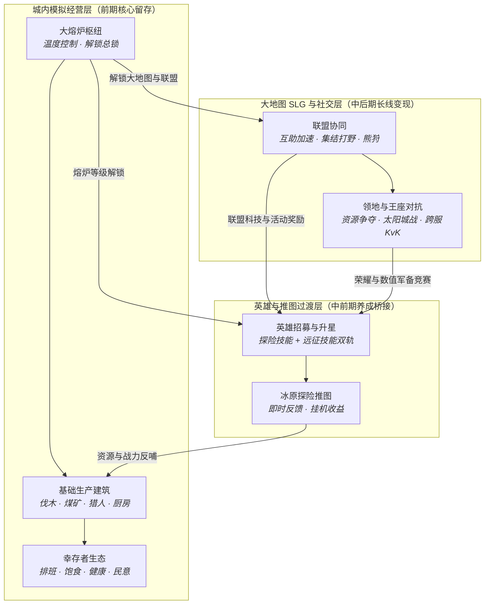
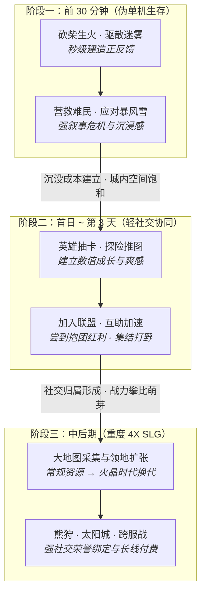
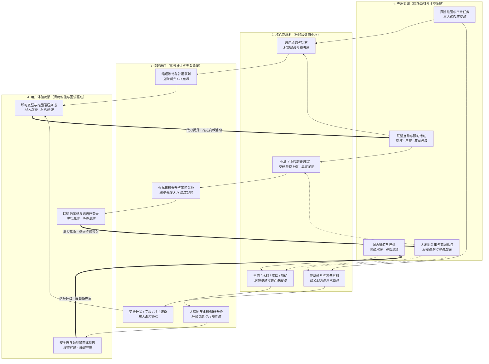
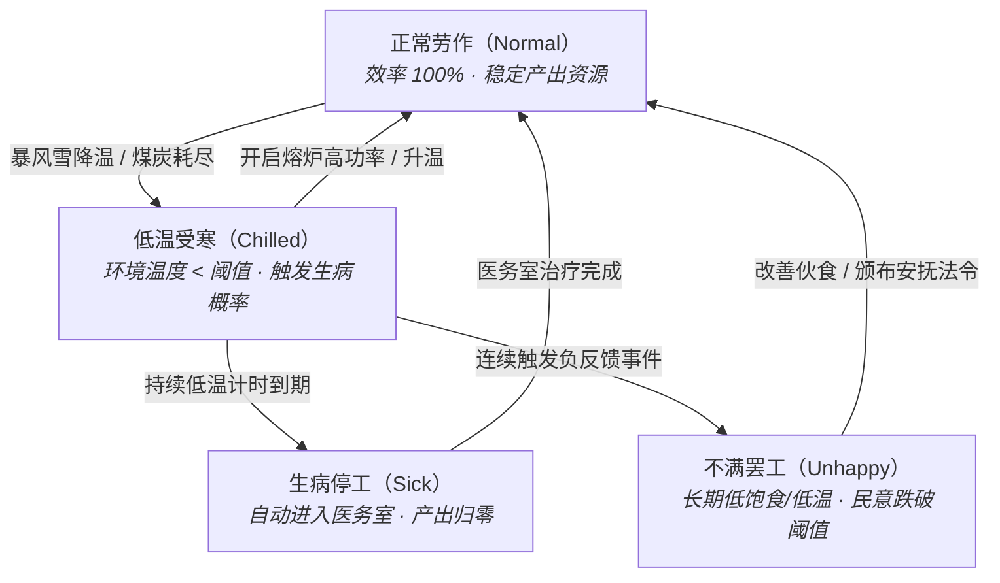
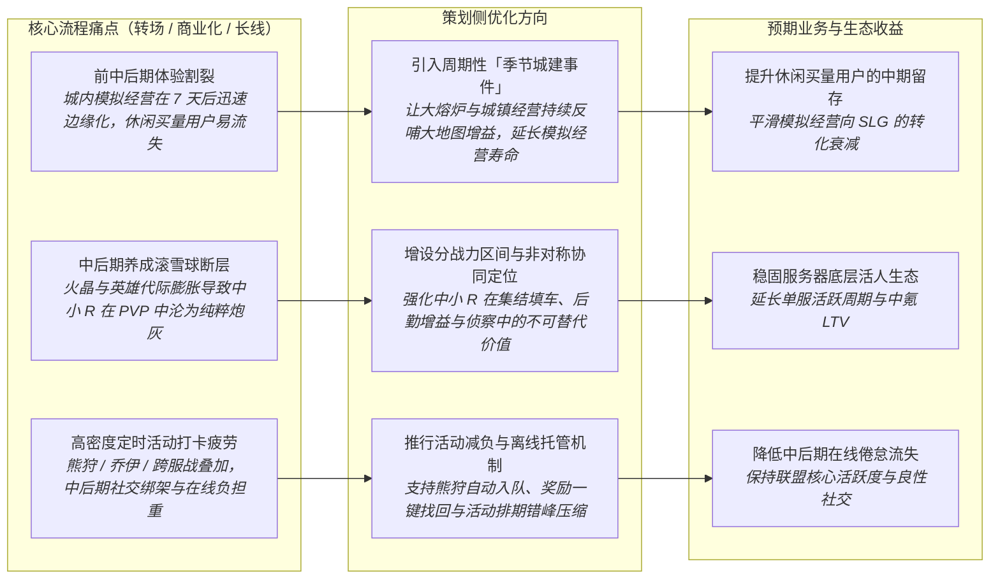

<h1 align="center">《无尽冬日》系统架构与商业化转场拆解报告</h1>

  游戏类型：冰雪生存模拟经营 + 4X SLG（SLG + X） &nbsp;|&nbsp; 开发商：点点互动 &nbsp;|&nbsp; 国内上线：2024.04（小游戏）/ 2024.06（App） &nbsp;|&nbsp; 拆解视角：系统策划

> **核心结论**：《无尽冬日》（*Whiteout Survival*）的商业成功并非颠覆了传统 COK-like SLG 的底层骨架，而是在系统策划层面跑通了 **「轻度生存模拟经营破冰 → 渐进式社交协同 → 重度 4X SLG 长线对抗」** 的三段式转场漏斗——既大幅拉低了买量泛用户的首日流失率，又无缝承接了中后期的高 ARPU 商业化与联盟生态留存。

---

## 目录

1. [产品定位与系统总览](#1-产品定位与系统总览)
2. [核心破冰设计：模拟经营的「减负」与「转场」](#2-核心破冰设计模拟经营的减负与转场)
3. [核心资源与多线养成闭环（含用户体验分析）](#3-核心资源与多线养成闭环含用户体验分析)
4. [中后期长线引擎：联盟生态与周期性活动矩阵](#4-中后期长线引擎联盟生态与周期性活动矩阵)
5. [商业化分层与隐性卡点设计](#5-商业化分层与隐性卡点设计)
6. [系统策划落地示例：大熔炉与幸存者状态机及配置表设计](#6-系统策划落地示例大熔炉与幸存者状态机及配置表设计)
7. [商业化与长线流程痛点及策划优化思路](#7-商业化与长线流程痛点及策划优化思路)

---

## 1. 产品定位与系统总览

### 1.1 产品基础资料

| 维度 | 产品信息 |
| :--- | :--- |
| **产品名称** | 《无尽冬日》（海外版：*Whiteout Survival*） |
| **研发与发行** | 世纪华通旗下点点互动（Century Games） |
| **上线节点** | 2022.12 海外上线；2024.04 国内微信小游戏上线；2024.06 国内 App 端上线（双端互通） |
| **核心品类** | 冰雪末日生存模拟经营（前期钩子）+ 4X SLG（中后期核心） |
| **商业模式** | F2P + 复合内购（直购礼包 + 抽卡养成 + 月卡/战令 + 竞争排行榜） |

### 1.2 宏观系统耦合架构

传统 SLG 最大的痛点是「开局即丢进大地图、概念复杂、前期种田枯燥」。《无尽冬日》通过四层模块化耦合，把「单机生存感」与「多人强对抗」拆解在不同生命周期阶段逐层释放：

图 1-1：《无尽冬日》城内模拟经营、英雄养成与大地图 SLG 三层系统耦合总图

<!-- 截图位：将实机主城大熔炉截图放入 _pages/works/media/wujin_furnace.jpg 后取消下方注释

   
  图 1-2：以大熔炉为核心的城内模拟经营主界面

-->

---

## 2. 核心破冰设计：模拟经营的「减负」与「转场」

### 2.1 大熔炉与幸存者系统的「减负哲学」

《无尽冬日》借用了《冰汽时代》的冰雪求生题材包装，但在系统复杂度上做了极其克制的**手游化减负**：

- **强视觉化的单一核心指标（温度）**：大熔炉既是全城供暖中心，也是所有建筑与玩法的「等级总锁」。暴风雪来袭时开启「最高功率」与画面结霜反馈，让玩家直观理解「为什么要升级熔炉和攒煤炭」，比传统 SLG 的「升级市政厅」具备强得多的情绪驱动力。
- **可控的微观管理 + 一键托管**：幸存者拥有饥饿、寒冷、生病、疲劳等拟真状态，但策划同时提供了极低操作成本的**一键分配/自动补位**机制——前期让玩家享受经营小镇的沉浸感，中后期则彻底退居后台，避免与繁重的 SLG 大地图操作抢夺精力。

### 2.2 「伪单机 → 轻协同 → 强对抗」三段式转场漏斗

这是本作最值得系统策划学习的流程设计。游戏通过**大熔炉等级节点**严格控制功能解锁节奏，防止泛用户过早被 SLG 的复杂规则劝退：

图 2-1：《无尽冬日》从轻度模拟经营平滑过渡至重度 SLG 的三阶段系统转场漏斗

---

## 3. 核心资源与多线养成闭环（含用户体验分析）

游戏通过 **「基础生存资源 → 通用加速/钻石 → 英雄与装备 → 中后期火晶换代」** 构建了分阶段递增的资源消耗结构，并将用户在不同阶段的情绪反馈（生存安全感、数值膨胀爽感、社交荣誉感）紧密织入资源循环：

图 3-1：《无尽冬日》核心资源「产出 → 流转 → 消耗 → 体验反馈」闭环结构图

### 英雄「双轨属性」的精妙设计
为了避免前期抽的英雄在转入 SLG 后沦为废卡，《无尽冬日》给每个英雄设计了两套独立技能体系：
- **探险技能（Explore）**：服务于前期 5v5 即时推图与竞技场，提供直观的动作特效与关卡破局爽感；
- **远征技能（Expedition）**：服务于中后期大地图带兵打仗、集结增益与驻防，直接决定联盟战中的数值含金量。

这种「一卡两用」的设计，让玩家前期的抽卡投入在游戏进入 SLG 阶段后实现**资产无缝保值**，显著降低了转场期的心理割裂感。

---

## 4. 中后期长线引擎：联盟生态与周期性活动矩阵

当城内模拟经营的新鲜感在 7～14 天后自然消退，《无尽冬日》依靠 **「强绑定社交 + 高密度活动排期」** 接棒长线留存：

| 活动 / 玩法模块 | 触发周期 | 核心系统机制 | 策划设计意图 |
| :--- | :--- | :--- | :--- |
| **巨熊行动（熊狩）** | 每 2 天 / 周期开启 | 全盟定时上线向巨熊发起集结，按总伤害发放稀有养成材料 | **锚定固定上线时间**，培养盟友定时协同习惯，强化中低氪对大佬集结车的依赖 |
| **疯狂的乔伊** | 周期性联盟 PVE | 敌军分波次进攻联盟成员主城，需互相派兵协防赚取积分 | 激活联盟内部**互助与沟通频率**，让弱势成员也能通过在线协防获得参与感 |
| **最强领主 / 周期竞赛** | 周常 / 半月循环 | 分阶段比拼「升战力 → 造兵 → 采集 → 杀敌」个人与联盟积分 | 制造**周期性资源囤积与集中倾泻节奏**，拉动加速道具与礼包消费峰值 |
| **太阳城争夺战 / 跨服 KvK** | 赛季 / 月度核心节点 | 顶级联盟争夺王座与服务器统治权，胜者享国王特权与官职分配 | 为头部大 R 提供最高维度的**社交炫耀与权力感**，同时以「本服荣誉」动员全服参战 |

---

## 5. 商业化分层与隐性卡点设计

《无尽冬日》的商业化核心在于**「生态分层」**——SLG 的大 R 需要海量中小 R 与免费活跃玩家作为「观众、盟友与对手」，因此商业化系统严格区分了不同付费层级的卡点与性价比：

1. **破冰与留存层（免费 / 微氪，6～68 元档）**：
   - **第二建造队列 / 额外行军队列**：直击前期时间稀缺痛点，一次解锁长期受益，是转化率最高的「破冰刚需」；
   - **月卡 / 战令 / 首充英雄**：提供超高性价比的日常加速与稳定产出，将微氪用户牢牢绑定在每日登录循环中。
2. **成长与竞争层（中氪，百元～千元档）**：
   - **限时弹出礼包**：在玩家大熔炉升级受阻、探险卡关或联盟活动冲榜的关键情绪节点精准触发；
   - **代际轮换英雄卡池**：随开服天数逐代解锁更强的新英雄，配合「幸运转盘」等保底机制，提供清晰可预期的阶段性付费目标。
3. **深坑与荣誉层（大 R，万元以上）**：
   - **领主装备、宝石、专武、宠物与火晶时代**：呈指数级扩张的养成深度，确保头部玩家在「太阳城战」和「跨服战」中拥有可感知的战力碾压与带队统治力。

---

## 6. 系统策划落地示例：大熔炉与幸存者状态机及配置表设计

为了将拆解从「体验观察」推进到「可落地开发」，下面以本作最具代表性的 **「大熔炉供暖 × 幸存者状态联动」** 为例，给出系统状态流转与核心配置表字段抽象：

### 6.1 幸存者状态流转状态机

图 6-1：大熔炉温度变化驱动下的幸存者核心状态机流转图

### 6.2 核心配置表字段设计示例（Excel / JSON 抽象）

**表 1：大熔炉等级配置表（`cfg_furnace_level`）**

| 字段名 | 类型 | 示例值 | 系统逻辑说明 |
| :--- | :--- | :--- | :--- |
| `furnace_lv` | `int` | `15` | 主键，大熔炉当前等级 |
| `pre_buildings` | `json` | `[{"id":102,"lv":14},{"id":105,"lv":14}]` | 前置建筑等级锁，驱动玩家均衡升级城建 |
| `cost_resources` | `json` | `{"wood":120000,"coal":45000,"fire_crystal":0}` | 升级所需资源（后期平滑接入 `fire_crystal` 火晶字段） |
| `upgrade_time_sec` | `int` | `14400` | 基础升级耗时（秒），受联盟互助与科研加速折减 |
| `base_temp_bonus` | `float` | `18.5` | 常规模式下提供的环境升温值（℃） |
| `overdrive_coal_per_min` | `int` | `120` | 开启「最高功率」时每分钟额外消耗的煤炭量 |
| `unlock_features` | `array<int>` | `[2001, 2005]` | 达到该等级时解锁的新玩法/新系统 ID（控制转场节奏） |

**表 2：暴风雪事件配置表（`cfg_blizzard_event`）**

| 字段名 | 类型 | 示例值 | 系统逻辑说明 |
| :--- | :--- | :--- | :--- |
| `event_id` | `int` | `301` | 暴风雪事件唯一 ID |
| `trigger_furnace_lv` | `int` | `8` | 触发该事件所需的最低大熔炉等级（新手保护隔离） |
| `temp_drop` | `float` | `-20.0` | 事件期间全局环境降温幅度 |
| `duration_sec` | `int` | `600` | 持续时长，制造短周期紧迫感而非长期折磨 |
| `sick_prob_per_tick` | `float` | `0.15` | 当室内温度低于安全线时，每检测周期的生病判定概率 |

> **关键边界与异常处理（策划防呆）**：
> 1. **离线保护机制**：玩家离线期间若煤炭耗尽或遭遇暴风雪，应限制幸存者死亡/掉级等不可逆惩罚（仅停产或进入轻度生病队列），防止玩家一觉醒来小镇崩盘导致直接流失；
> 2. **一键派驻兜底**：当幸存者从医务室痊愈或新难民加入时，系统自动按「煤矿/厨房优先」的权重队列补位，减少中后期高频手动微操。

---

## 7. 商业化与长线流程痛点及策划优化思路

从系统策划视角复盘，《无尽冬日》在中后期依然面临 SLG+X 融合品类的典型流程痛点：

图 7-1：针对《无尽冬日》体验转场、生态分层与在线负担的系统策划优化思路

---
